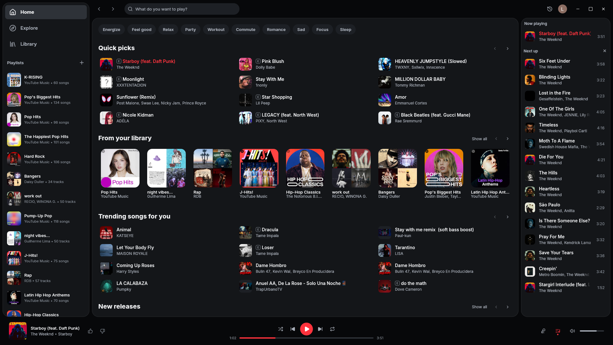
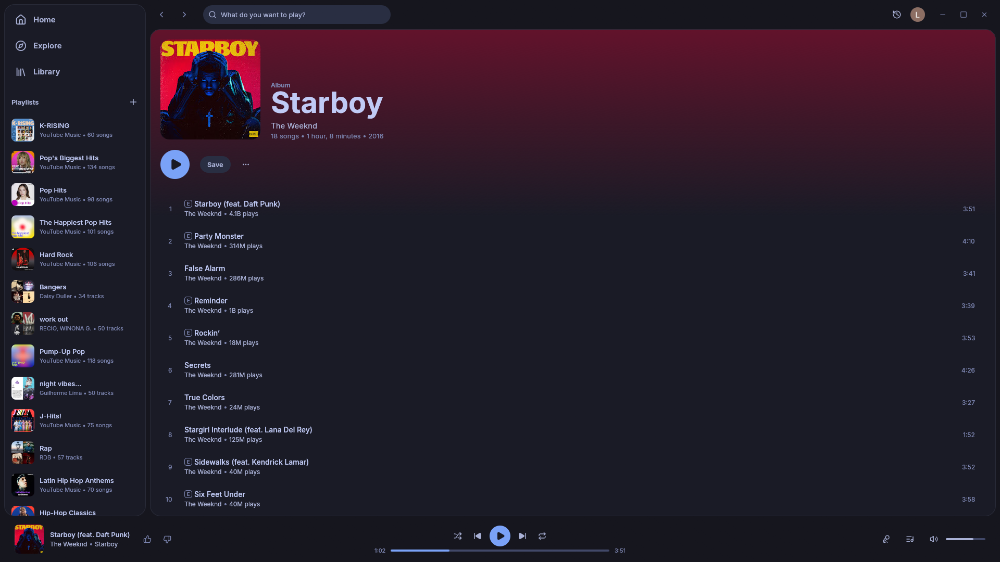
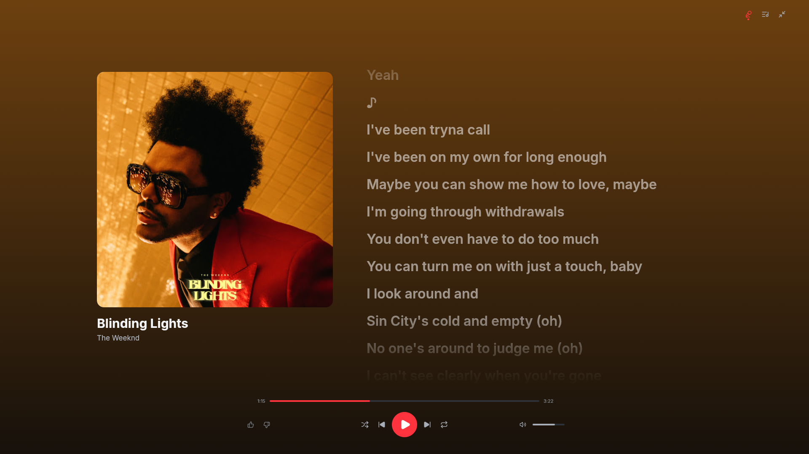
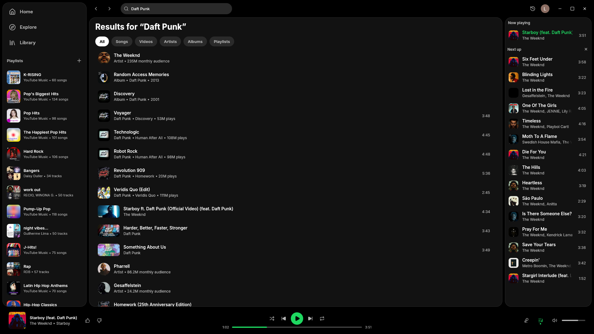
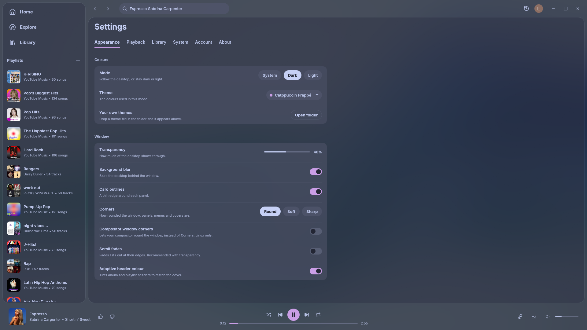

<p align="center">
  
</p>

<h1 align="center">refryt</h1>

<p align="center">A native YouTube Music client for Linux, Windows and macOS.</p>

<p align="center">
  <a href="https://github.com/gridoe/refryt/releases/latest"></a>
  <a href="LICENSE"></a>
  
</p>

<p align="center">
  <a href="assets/screenshots/home-classic.png"></a>
  <a href="assets/screenshots/home-catppuccin-frappe-blur.png"></a>
</p>

<details>
<summary>More screenshots</summary>

<p align="center">
  <a href="assets/screenshots/macos-home-classic-blur.png"></a>
  <a href="assets/screenshots/macos-fullscreen-player.png"></a>
</p>

<p align="center">
  <a href="assets/screenshots/album.png"></a>
  <a href="assets/screenshots/artist.png"></a>
</p>

<p align="center">
  <a href="assets/screenshots/fullscreen-lyrics.png"></a>
  <a href="assets/screenshots/spotify-theme.png"></a>
</p>

<p align="center">
  <a href="assets/screenshots/icon-rail-and-queue.png"></a>
  <a href="assets/screenshots/settings.png"></a>
</p>

</details>

refryt is a desktop client for YouTube Music written in Rust. There is no browser engine behind it. Playback goes through mpv, and the app talks to YouTube through the same internal API the website uses.

- Home, Explore, search, a library, synced lyrics, an editable queue and music videos.
- 23 themes, with optional window transparency and background blur.
- Memory use is typically between 100 and 300 MB, depending on the session.
- Packages for Linux (AppImage and Flatpak), Windows (installer, MSI and zip, plus an ARM64 build) and macOS (Apple Silicon DMG).

## Install

Downloads are on the [releases page](https://github.com/gridoe/refryt/releases), with a `SHA256SUMS` file to check them against.

### Linux

**Flatpak**

```
flatpak install --user https://gridoe.github.io/refryt/refryt.flatpakref
```

Update it with `flatpak update`. The browser import and Launch on startup are not available inside the sandbox.

**AppImage:** download `refryt-<version>-x86_64.AppImage`, make it executable with `chmod +x` and run it.

**AUR:** `refryt-bin`, an unofficial package of the AppImage, for example `yay -S refryt-bin`.

### Windows

**Installer:** `refryt-<version>-windows-x86_64-setup.exe`, or the `.msi` for silent installs (`msiexec /i <file> /qn`). Both are unsigned, so SmartScreen warns on the first run.

**Scoop**

```powershell
scoop bucket add gridoe https://github.com/gridoe/scoop-bucket
scoop install gridoe/refryt
```

**Zip:** extract the whole folder and run `refryt.exe`.

The ARM64 `.msi` and `.zip` are native builds that have not been tested on ARM hardware.

### macOS

Apple Silicon only.

**Homebrew:** `brew install --cask gridoe/tap/refryt`

**Disk image:** open `refryt-<version>-macos-arm64.dmg` and drag Refryt to Applications.

The app is not notarised, so run `xattr -cr /Applications/Refryt.app` once before the first launch.

### Updates

refryt checks for a new release when it starts; the check can be turned off in Settings, About. The installer, the MSI and the AppImage update themselves with one click. The others show the command to run (`flatpak update`, `brew upgrade --cask refryt`, `scoop update refryt`) or a link to the release.

To build from source, see [Build from source](#build-from-source).

## Disclaimer

> [!IMPORTANT]
> refryt is not a piracy tool. It hosts, shares and unlocks no content. Every song is streamed from YouTube under the account that is signed in.

- refryt is meant for use with YouTube Premium or YouTube Music Premium. Downloads only work for a Premium account and are for personal offline listening.
- Likes, playlist edits and history are saved to the YouTube account, so they show up on the website and in the mobile apps too.
- refryt is unofficial and not affiliated with, endorsed by or sponsored by YouTube or Google. "YouTube" and "YouTube Music" are trademarks of Google LLC. It uses YouTube's undocumented internal API, and third-party clients fall outside YouTube's Terms of Service.

## Features

- Search by songs, albums or artists, each asked from YouTube directly.
- Playlists you can create, rename and reorder by dragging, with YouTube's suggestions on your own.
- Liked songs marked everywhere, and a tile on each artist page with the ones you liked.
- Home's sections in the order you choose.
- A fullscreen player with the cover, synced lyrics and a queue drawer (F to open, Esc to close).
- Local folders, browsable like a file tree, and any folder as a playlist.
- Downloads with Premium, to `~/Music/refryt` with tags and cover art, and an offline mode that points to them.
- Audio quality, volume normalisation and autoplay when the queue runs out.
- Brand account switching from the account menu.
- Tray icon, start on boot, media keys, system media controls, and optional Discord Rich Presence.
- Resizable sidebars; the left one folds down to an icon rail.

## Using refryt

### Keyboard shortcuts

| Key | Action |
|---|---|
| Space | Play or pause |
| Up / Down | Previous / next song |
| Ctrl + Up / Down | Volume up / down |
| M | Mute |
| F | Open or close the fullscreen player |
| Esc | Close the queue drawer, then the fullscreen player |
| Ctrl + S | Shuffle |
| Ctrl + R | Cycle repeat mode |
| Ctrl + K or Ctrl + L | Jump to search |
| ? or F1 | Show the full list |

On macOS, Ctrl is Cmd. One click selects a song and two play it, as in Spotify; a setting makes one click play.

### Themes

The 23 themes are CSS files in the config folder's `themes` folder, and can be edited or added ([docs/THEMES.md](docs/THEMES.md)). Settings has window transparency and background blur. Blur works on KDE Plasma under Wayland, compositors with ext-background-effect (niri, GNOME 51 and newer), Windows and macOS.

### Signing in

Sign in from the app's own window, or use Import from browser on Home or in Settings, which takes the session of the browser you used last. It knows Firefox and its forks, Chrome, Chromium, Brave, Vivaldi, Edge, Opera, Whale and Helium. On Windows, browsers that use app-bound cookie encryption are left out, and the Flatpak has only the app's window. Signed out, refryt still searches and plays.

### Data and privacy

Settings, themes, the session and the log live in `~/.config/refryt` on Linux, `~/Library/Application Support/refryt` on macOS and `~/.var/app/io.github.gridoe.refryt/config/refryt` in the Flatpak. The session is stored with owner-only permissions.

There is no telemetry. refryt connects to YouTube, [LRCLIB](https://lrclib.net) for lyrics, GitHub for the update check, and Discord's local client if Rich Presence is on. LRCLIB and the update check can be turned off in Settings. Crash reports stay on disk until you choose to copy or file them. [PRIVACY.md](PRIVACY.md) has the details.

## Status

The project is before 1.0 and changes quickly. Only the Linux builds see daily use; the Windows builds are cross-compiled with limited testing on real hardware, and the macOS build has been tested by hand. Podcasts are not supported. A change to YouTube's internal API can break playback or a page until a fix is released.

Bugs go to the [issue tracker](https://github.com/gridoe/refryt/issues); [CONTRIBUTING.md](CONTRIBUTING.md) says what to include.

## Build from source

`just` builds and runs the app, `just release` makes the optimised build, and `just check` runs formatting, clippy and the tests. It needs Rust and libmpv, and yt-dlp optionally. [docs/BUILDING.md](docs/BUILDING.md) covers the full setup, the Windows cross-build, the Flatpak and releases.

Built with Rust and [egui](https://github.com/emilk/egui), [mpv](https://mpv.io/) for playback, YouTube's `player` endpoint for streams with [yt-dlp](https://github.com/yt-dlp/yt-dlp) as the fallback, and [`ytmapi-rs`](https://github.com/nick42d/youtui) for the InnerTube API.

## Credits

- **[Sonora](https://github.com/sonorahq/sonora)** and its
  [`ytmusic-rs`](https://github.com/sonorahq/ytmusic-rs): asking YouTube's `player` endpoint
  as the visionOS client, which hands back direct stream URLs, and retrying with the visitor
  id a refusal issues.
- **[yt-dlp](https://github.com/yt-dlp/yt-dlp)**: the fallback resolver, and the reference
  for how YouTube gates anonymous clients.
- **[youtui](https://github.com/nick42d/youtui)**: `ytmapi-rs` for the InnerTube API, and its
  maintained `rusty_ytdl` fork behind the optional native resolver.
- **[ytmdesktop](https://github.com/ytmdesktop/ytmdesktop)**: what happens when the queue
  runs out.
- **Spotify's desktop app**: the shortcuts, select-then-play clicks, and the shape of the
  album, playlist and artist pages.
- **[LRCLIB](https://lrclib.net)**: the synced lyrics.
- **Theme palettes**: [Catppuccin](https://github.com/catppuccin/palette),
  [Nord](https://www.nordtheme.com/docs/colors-and-palettes),
  [Gruvbox](https://github.com/morhetz/gruvbox),
  [Tokyo Night](https://github.com/folke/tokyonight.nvim),
  [Dracula](https://spec.draculatheme.com), [Rosé Pine](https://github.com/rose-pine/palette),
  [Everforest](https://github.com/sainnhe/everforest),
  [Solarized](https://ethanschoonover.com/solarized) and Spotify's own colours. Each file in
  `crates/refryt/themes` names its source.

## Licence

[GPL-3.0-or-later](LICENSE).
