<p align="center">
  <picture>
    <source media="(prefers-color-scheme: dark)" srcset="assets/hero-dark.webp">
    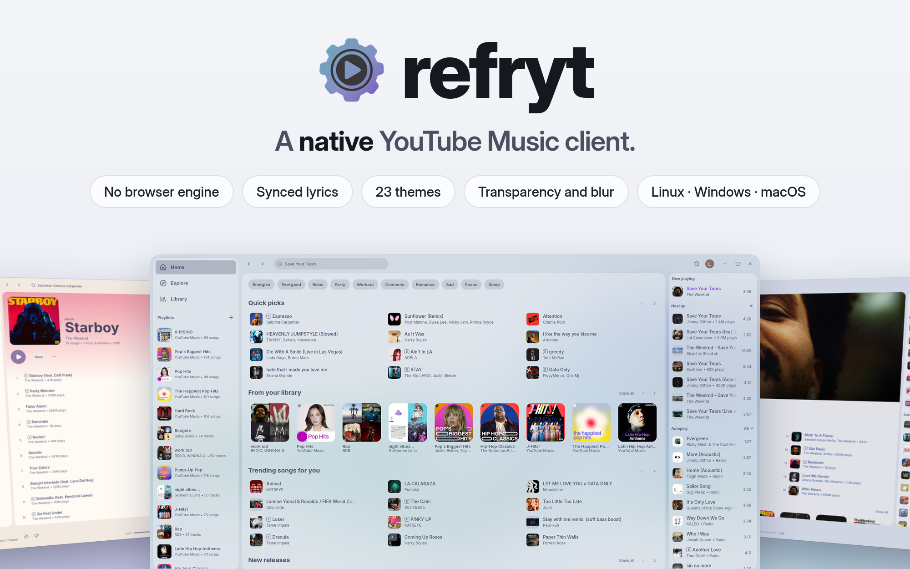
  </picture>
</p>

<p align="center">
  <a href="https://github.com/gridoe/refryt/releases/latest"></a>
  <a href="LICENSE"></a>
  
</p>

<details>
<summary>The banner in the other theme</summary>
<p align="center">
  <picture>
    <source media="(prefers-color-scheme: dark)" srcset="assets/hero-light.webp">
    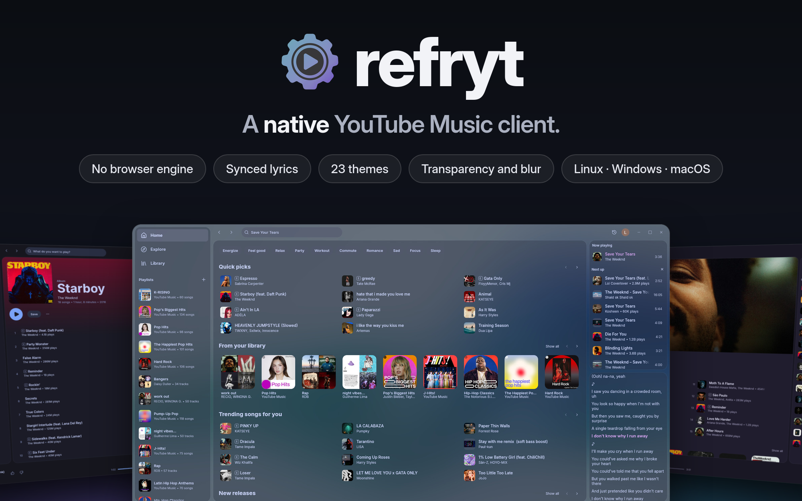
  </picture>
</p>
</details>

refryt is a native YouTube Music app for your desktop, written in Rust. There's no browser hiding inside it: music plays through mpv, and the app talks to YouTube the same way the website does. It opens fast and stays light.

- Everything you'd expect: Home, Explore, search, your library, an editable queue and music videos.
- Synced lyrics from seven sources, picked for you automatically, and romanised for Japanese, Korean and Chinese songs.
- Your listening stats, with a page for every artist and song you play.
- 29 themes, plus GTK and Qt on Linux to match your desktop, with optional transparency and background blur.
- Usually 100 to 300 MB of memory, depending on what you're doing.
- Packages for Linux (AppImage and Flatpak), Windows (installer, MSI and zip, plus an ARM64 build) and macOS (Apple Silicon DMG).

## Screenshots

<table>
  <tr>
    <td width="50%"><a href="assets/screenshots/home-catppuccin-frappe-blur.webp">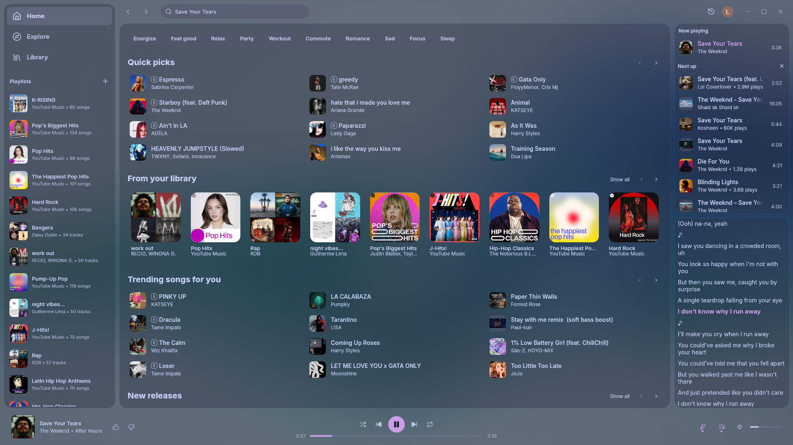</a><br><sub>Home with the queue and lyrics, Catppuccin Frappé, transparent with blur*</sub></td>
    <td width="50%"><a href="assets/screenshots/home-catppuccin-latte-blur.webp">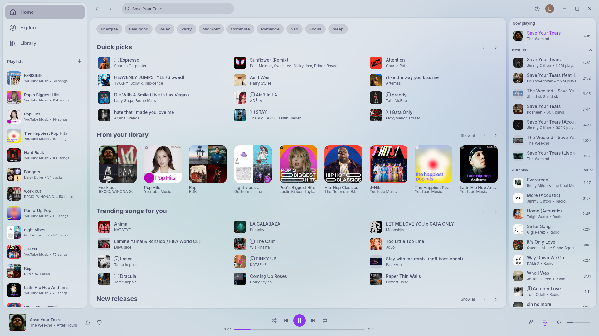</a><br><sub>Home and the queue, Catppuccin Latte, transparent with blur*</sub></td>
  </tr>
  <tr>
    <td width="50%"><a href="assets/screenshots/now-playing.webp">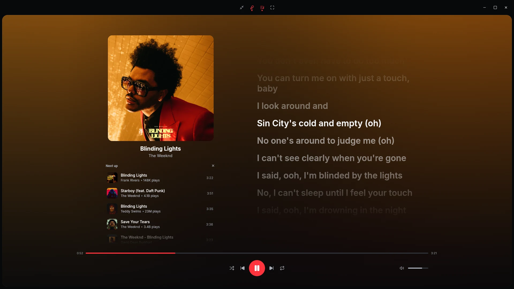</a><br><sub>Now playing with the queue and lyrics, Classic Dark</sub></td>
    <td width="50%"><a href="assets/screenshots/now-playing-catppuccin-latte.webp">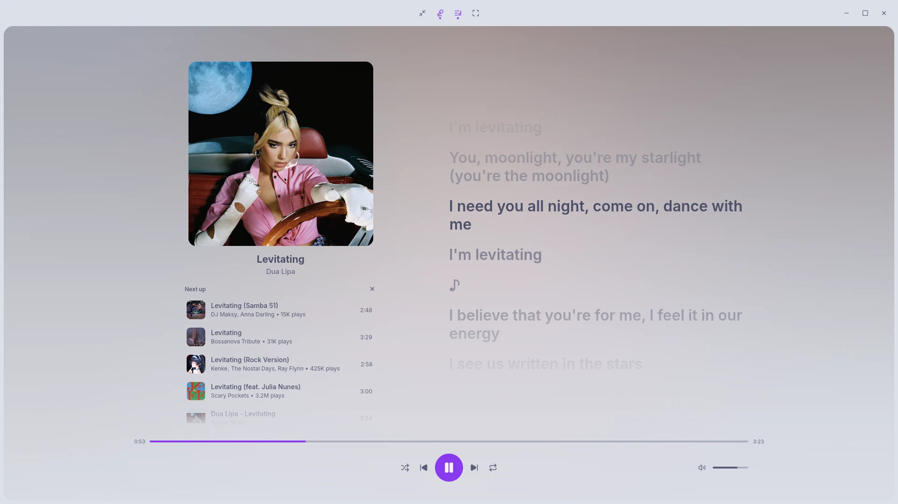</a><br><sub>Now playing with the queue and lyrics, Catppuccin Latte</sub></td>
  </tr>
</table>

<details>
<summary>More screenshots</summary>
<br>
<table>
  <tr>
    <td width="50%"><a href="assets/screenshots/home-classic.png">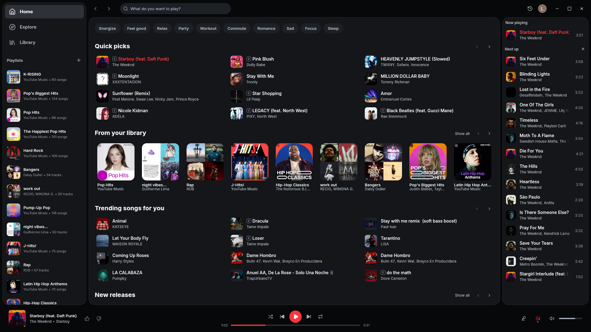</a><br><sub>Home and the queue, Classic Dark</sub></td>
    <td width="50%"><a href="assets/screenshots/home-classic-light.webp">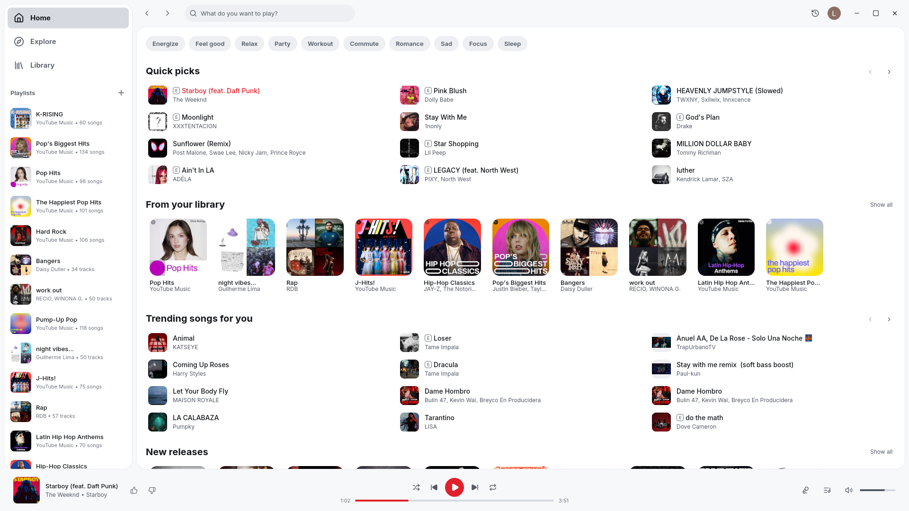</a><br><sub>Home, Classic Light</sub></td>
  </tr>
  <tr>
    <td width="50%"><a href="assets/screenshots/album.png">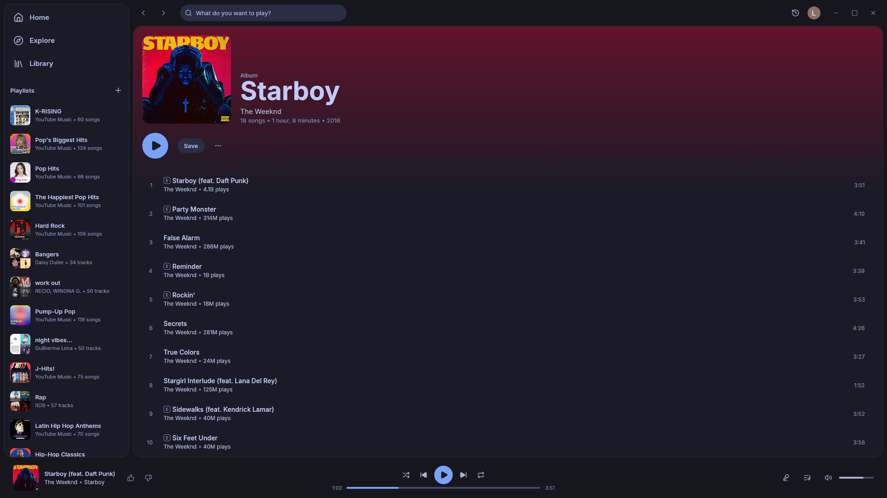</a><br><sub>An album, Tokyo Night</sub></td>
    <td width="50%"><a href="assets/screenshots/album-rose-pine-dawn.webp">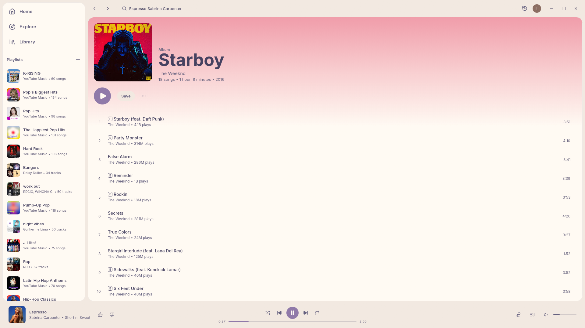</a><br><sub>An album, Rosé Pine Dawn</sub></td>
  </tr>
  <tr>
    <td width="50%"><a href="assets/screenshots/artist.webp">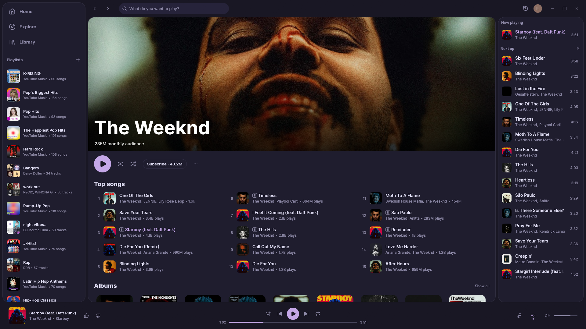</a><br><sub>An artist and the queue, Rosé Pine</sub></td>
    <td width="50%"><a href="assets/screenshots/autoplay-filter.webp">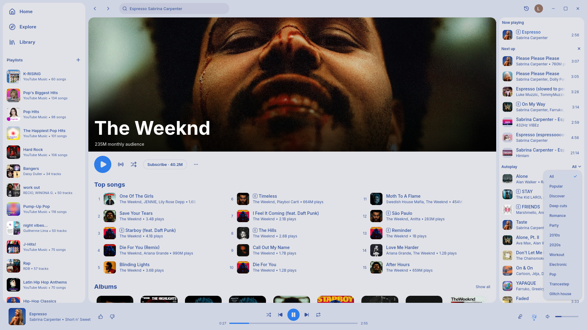</a><br><sub>The Autoplay filter in the queue, Tokyo Night Day</sub></td>
  </tr>
  <tr>
    <td width="50%"><a href="assets/screenshots/explore-catppuccin-mocha.webp">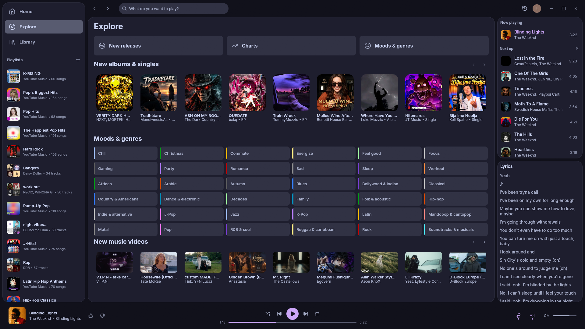</a><br><sub>Explore with the queue and lyrics, Catppuccin Mocha</sub></td>
    <td width="50%"><a href="assets/screenshots/explore-gruvbox-light.webp">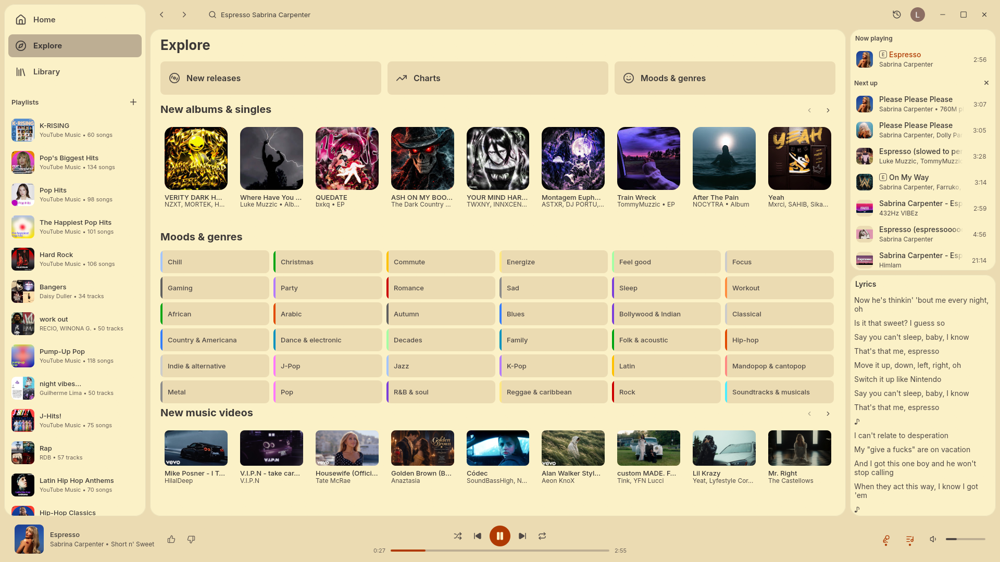</a><br><sub>Explore with the queue and lyrics, Gruvbox Light</sub></td>
  </tr>
  <tr>
    <td width="50%"><a href="assets/screenshots/icon-rail.webp">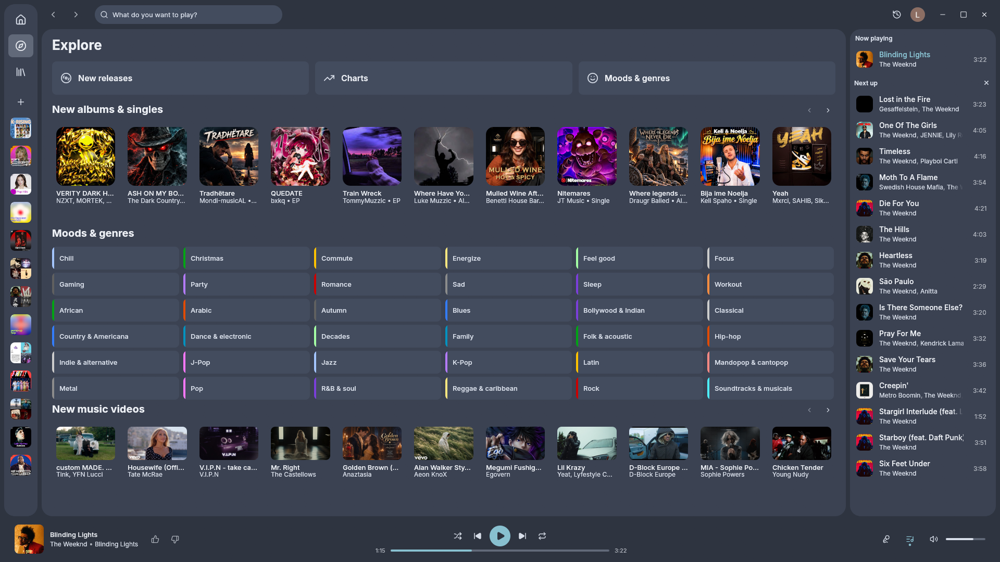</a><br><sub>The sidebar folded to the icon rail, Nord Polar Night</sub></td>
    <td width="50%"><a href="assets/screenshots/library-everforest-light.webp">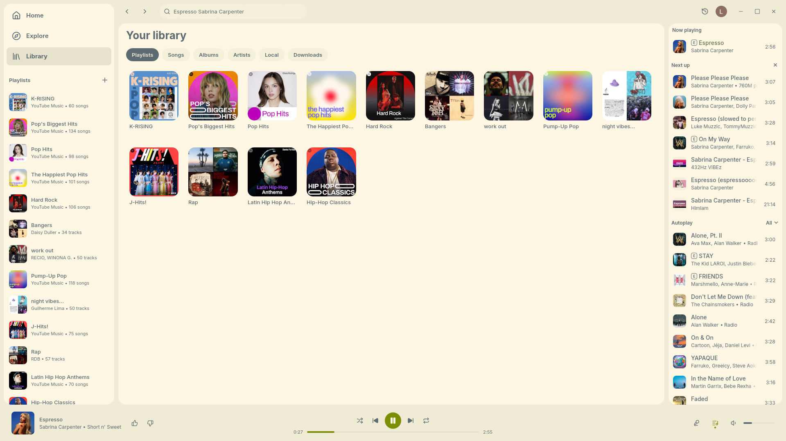</a><br><sub>The library and the queue, Everforest Light</sub></td>
  </tr>
  <tr>
    <td width="50%"><a href="assets/screenshots/spotify-theme.png">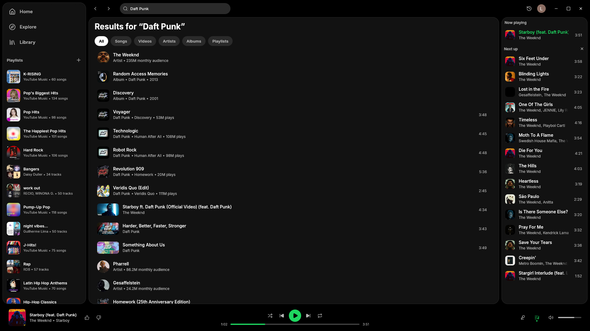</a><br><sub>Search and the queue, Spotify</sub></td>
    <td width="50%"><a href="assets/screenshots/home-solarized-light.webp">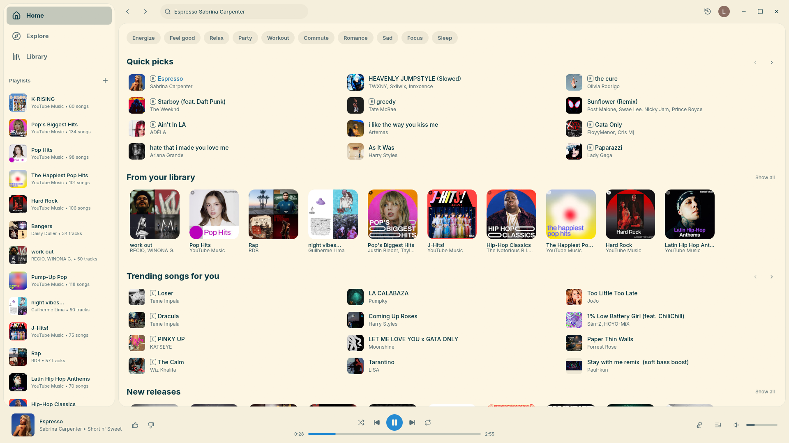</a><br><sub>Home, Solarized Light</sub></td>
  </tr>
  <tr>
    <td width="50%"><a href="assets/screenshots/stats-tokyo-night.webp">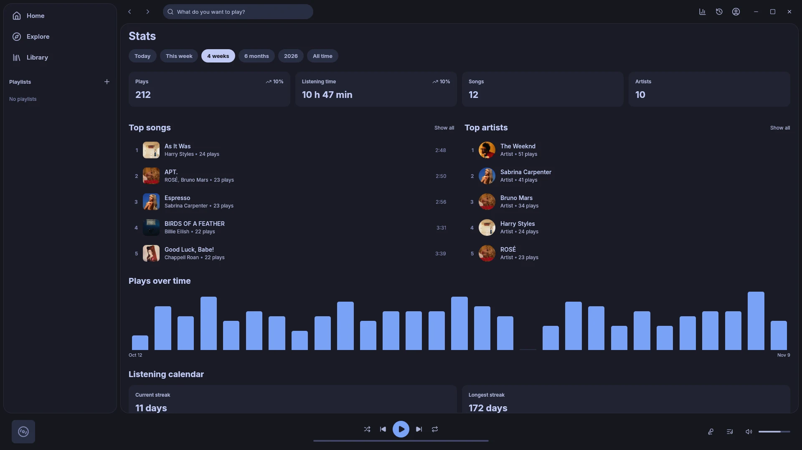</a><br><sub>Stats, Tokyo Night</sub></td>
    <td width="50%"><a href="assets/screenshots/settings.png">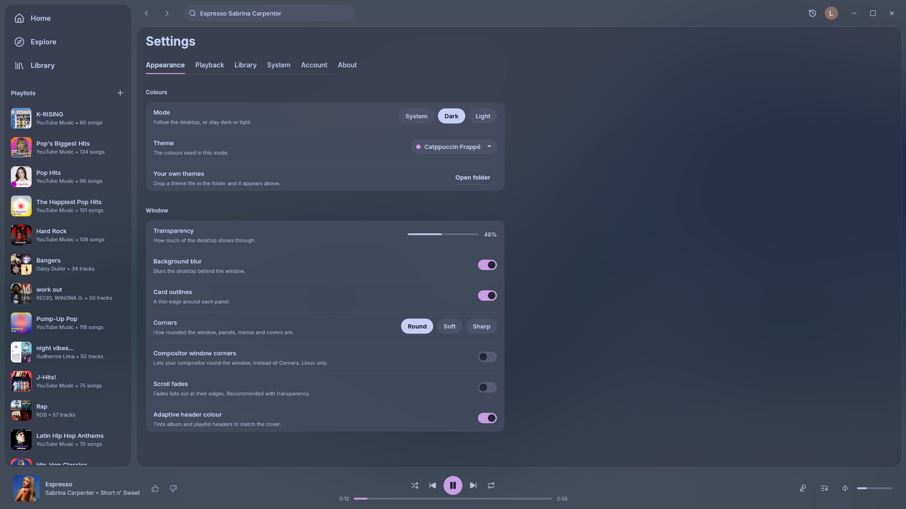</a><br><sub>Settings, Catppuccin Frappé, transparent with blur*</sub></td>
  </tr>
  <tr>
    <td width="50%"><a href="assets/screenshots/macos-home-classic-blur.png"></a><br><sub>macOS: Home, Classic Dark, transparent with blur</sub></td>
    <td width="50%"><a href="assets/screenshots/macos-fullscreen-player.png"></a><br><sub>macOS: the fullscreen player</sub></td>
  </tr>
</table>
</details>

<sub>* On Linux the blur comes from the compositor, which the app's own screenshot can't capture, so it was added afterwards over a blurred wallpaper. The transparency is the app's.</sub>

## Install

Grab the latest build from the [releases page](https://github.com/gridoe/refryt/releases). Each release has a `SHA256SUMS` file if you want to check your download.

### Linux

**Flatpak**

```
flatpak install --user https://gridoe.github.io/refryt/refryt.flatpakref
```

`flatpak update` keeps it up to date. Inside the sandbox you'll miss two things: the browser import and Launch on startup.

**AppImage:** download `refryt-<version>-x86_64.AppImage`, make it executable with `chmod +x`, and you're ready to go. You can also install via an AppImage manager such as Gear Lever or Shelly. Either way, it updates itself in one click when a new release is out.

**AUR:** on Arch, `yay -S refryt-bin` installs the AppImage, and `refryt-git` builds the latest code from source. Both are unofficial packages, kindly maintained by [9M2PJU](https://github.com/9M2PJU), and they may lag a little behind the latest release.

### Windows

**Installer:** run `refryt-<version>-windows-x86_64-setup.exe`, or use the `.msi` for silent installs (`msiexec /i <file> /qn`). Both update themselves in one click when a new release is out. Neither is signed yet, so SmartScreen will warn you the first time; choose "More info", then "Run anyway".

**Scoop**

```powershell
scoop bucket add gridoe https://github.com/gridoe/scoop-bucket
scoop install gridoe/refryt
```

**Zip:** extract the whole folder and run `refryt.exe`. Nothing gets installed.

There are native ARM64 builds too (`.msi` and `.zip`). They haven't been tried on real ARM hardware yet, so feedback is very welcome.

### macOS

Apple Silicon only.

**Homebrew:** `brew install --cask gridoe/tap/refryt`

**Disk image:** open `refryt-<version>-macos-arm64.dmg` and drag Refryt to Applications.

The app isn't notarised by Apple, so macOS will refuse to open it at first. Run `xattr -cr /Applications/Refryt.app` once and it opens normally from then on.

### Updates

refryt looks for a new release when it starts, and tells you when there is one (you can turn this off in Settings, About). The installer, the MSI and the AppImage update themselves in one click. For the others, it shows you the command to run (`flatpak update`, `brew upgrade --cask refryt`, `scoop update refryt`) or links to the release.

Prefer to build it yourself? See [Build from source](#build-from-source).

## Disclaimer

> [!IMPORTANT]
> refryt is not a piracy tool. It hosts, shares and unlocks no content. Every song is streamed from YouTube under the account that is signed in.

- refryt is meant for use with YouTube Premium or YouTube Music Premium. Downloads only work for a Premium account and are for personal offline listening.
- Likes, playlist edits and history are saved to the YouTube account, so they show up on the website and in the mobile apps too.
- refryt is unofficial and not affiliated with, endorsed by or sponsored by YouTube or Google. "YouTube" and "YouTube Music" are trademarks of Google LLC. It uses YouTube's undocumented internal API, and third-party clients fall outside YouTube's Terms of Service.

## Features

- Search songs, albums or artists, straight from YouTube.
- Make playlists, rename them and drag songs around, with YouTube's suggestions for your own playlists.
- Your liked songs are marked everywhere, and each artist page has a tile with the ones you liked.
- Put Home's sections in whatever order you like.
- A now-playing view with the cover, synced lyrics and the queue (F opens it, F11 goes fullscreen, Esc closes it).
- Lyrics from BetterLyrics, lrc.red, LRCLIB, KuGou, Unison and YouTube Music. You choose which to use and in what order, and can switch sources for any song.
- Stats on what you listen to: top songs and artists, plays over time, and a page for every artist and song with your ranks, first plays and best days.
- Your local music folders, browsable like a file tree, and any folder can be played as a playlist.
- With Premium, download songs to `~/Music/refryt` with tags and cover art, and listen offline.
- Audio quality, volume normalisation, and autoplay that keeps the music going when the queue ends.
- Switch between brand accounts from the account menu.
- Tray icon, start on boot, media keys, system media controls and optional Discord Rich Presence.
- Cast from the YouTube Music app on your phone, and use the phone as the remote.
- Resizable sidebars; the left one folds down to an icon rail.

## Using refryt

### Keyboard shortcuts

| Key | Action |
|---|---|
| Space | Play or pause |
| Up / Down | Previous / next song |
| Ctrl + Up / Down | Volume up / down |
| M | Mute |
| F | Open or close the now-playing view |
| F11 | Open the now-playing view in fullscreen; in it, fullscreen on or off |
| Esc | Close the now-playing view |
| Ctrl + S | Shuffle |
| Ctrl + R | Cycle repeat mode |
| Ctrl + K or Ctrl + L | Jump to search |
| ? or F1 | Show the full list |

On macOS, Ctrl is Cmd. One click selects a song and two play it, as in Spotify; a setting makes one click play.

### Themes

There are 29 themes, and on Linux two more, GTK and Qt, that take their colours from your desktop. A fresh install starts on the one that matches your system. Every theme is a CSS file in the config folder's `themes` folder, so you can tweak them or make your own ([docs/THEMES.md](docs/THEMES.md)). Settings also has window transparency and background blur. Blur works on KDE Plasma under Wayland, compositors with ext-background-effect (niri, GNOME 51 and newer), Windows and macOS.

### Casting from a phone

With "Cast from YouTube Music" on in Settings, System, the computer shows up in the Cast menu of the YouTube Music app on phones on the same network, next to the TVs and speakers. What the phone casts plays in refryt: its queue becomes refryt's queue, and play, pause, seek, skip and volume work from either side. The YouTube app can cast to it too, and plays as audio.

It is off by default, and it is on or off per network. Switched on, it comes back on by itself whenever the computer is on that network again; on any other, such as public Wi-Fi, it stays off and the computer doesn't show up until you switch it on there too. Networks are told apart by their router, so this works on a cable as on Wi-Fi, and a hotspot named like your Wi-Fi doesn't count as it. The other networks it's on for are listed under the setting and can be removed.

While it runs, refryt answers device discovery on the local network (UDP port 1900) and takes pairing requests on TCP port 47023, and any device on the network can start playback, as with a TV or a Chromecast. If another program already holds 47023, refryt pairs on a free port for that run instead, and the ? next to the setting shows which. Nothing is cast in the other direction: refryt is a receiver, not a remote for other devices.

If the computer doesn't show up in the phone's Cast menu, a firewall is usually the reason. Both ports have to be let in:

- **Linux** with ufw: `sudo ufw allow from 192.168.0.0/16 to any port 1900 proto udp` and `sudo ufw allow from 192.168.0.0/16 to any port 47023 proto tcp`, with your own network's range if it isn't `192.168.x.x`. With firewalld: `sudo firewall-cmd --permanent --add-port=1900/udp --add-port=47023/tcp` and `sudo firewall-cmd --reload`. The ? next to the setting has these ready to copy, for your network and port.
- **Windows** Firewall needs a rule for refryt, including on a network Windows calls Public, and its own "allow access" prompt doesn't always leave one. The ? next to the setting has PowerShell commands ready to copy, for this copy of refryt and your network's range, to run as administrator.
- **macOS** may ask whether refryt may accept incoming connections. Allow it.

### Signing in

Sign in from the app's own window, or skip that and use Import from browser on Home or in Settings, which picks up the session from the browser you used last. It knows Firefox and its forks, Chrome, Chromium, Brave, Vivaldi, Edge, Opera, Whale and Helium. On Windows, browsers that use app-bound cookie encryption are left out, and the Flatpak has only the app's window. You don't have to sign in at all: signed out, refryt still searches and plays.

### Data and privacy

Settings, themes, the session and the log live in `~/.config/refryt` on Linux, `~/Library/Application Support/refryt` on macOS and `~/.var/app/io.github.gridoe.refryt/config/refryt` in the Flatpak. The session is stored with owner-only permissions.

refryt has no telemetry. It connects to YouTube and a few lyrics sites (BetterLyrics, lrc.red, LRCLIB, KuGou and Unison) for lyrics, GitHub for the update check, and Discord's local client if Rich Presence is on. Each lyrics source and the update check can be turned off in Settings. Crash reports stay on disk until you choose to copy or file them. [PRIVACY.md](PRIVACY.md) has the details.

## Status

refryt is young (it hasn't reached 1.0) and moves quickly. Linux is where it gets used every day. The Windows builds are cross-compiled and have had less testing on real hardware, and the macOS build has been tested by hand. Podcasts aren't supported. Now and then YouTube changes its internal API, which can break playback or a page until a fix is out.

Found a bug? Please open an [issue](https://github.com/gridoe/refryt/issues); [CONTRIBUTING.md](CONTRIBUTING.md) says what helps. Reports from Windows and macOS are especially welcome.

## Build from source

`just` builds and runs the app, `just release` makes the optimised build, and `just check` runs formatting, clippy and the tests. It needs Rust and libmpv, and yt-dlp optionally. [docs/BUILDING.md](docs/BUILDING.md) covers the full setup, the Windows cross-build, the Flatpak and releases.

Built with Rust and [egui](https://github.com/emilk/egui), [mpv](https://mpv.io/) for playback, YouTube's `player` endpoint for streams with [yt-dlp](https://github.com/yt-dlp/yt-dlp) as the fallback, and [`ytmapi-rs`](https://github.com/nick42d/youtui) for the InnerTube API.

## Credits

- **[Sonora](https://github.com/sonorahq/sonora)** and its
  [`ytmusic-rs`](https://github.com/sonorahq/ytmusic-rs): asking YouTube's `player` endpoint
  as the visionOS client, which hands back direct stream URLs, and retrying with the visitor
  id a refusal issues.
- **[yt-dlp](https://github.com/yt-dlp/yt-dlp)**: the fallback resolver, and the reference
  for how YouTube gates anonymous clients.
- **[youtui](https://github.com/nick42d/youtui)**: `ytmapi-rs` for the InnerTube API, and its
  maintained `rusty_ytdl` fork behind the optional native resolver.
- **[ytmdesktop](https://github.com/ytmdesktop/ytmdesktop)**: what happens when the queue
  runs out.
- **Spotify's desktop app**: the shortcuts, select-then-play clicks, and the shape of the
  album, playlist and artist pages.
- **[BetterLyrics](https://github.com/better-lyrics/better-lyrics)**, **[lrc.red](https://lrc.red)**, **[LRCLIB](https://lrclib.net)**, **[KuGou](https://www.kugou.com)** and **Unison**: lyrics.
- **[BitChord](https://github.com/kushagrasinghx/BitChord)**: lyrics from several sources, tried in an order you set.
- **Theme palettes**: [Catppuccin](https://github.com/catppuccin/palette),
  [Nord](https://www.nordtheme.com/docs/colors-and-palettes),
  [Gruvbox](https://github.com/morhetz/gruvbox),
  [Tokyo Night](https://github.com/folke/tokyonight.nvim),
  [Dracula](https://spec.draculatheme.com), [Rosé Pine](https://github.com/rose-pine/palette),
  [Everforest](https://github.com/sainnhe/everforest),
  [Solarized](https://ethanschoonover.com/solarized), Spotify's own colours, the system
  colours of macOS and Windows 11, and KDE Plasma's Breeze. Each file in
  `crates/refryt/themes` names its source.

## Licence

[GPL-3.0-or-later](LICENSE).
